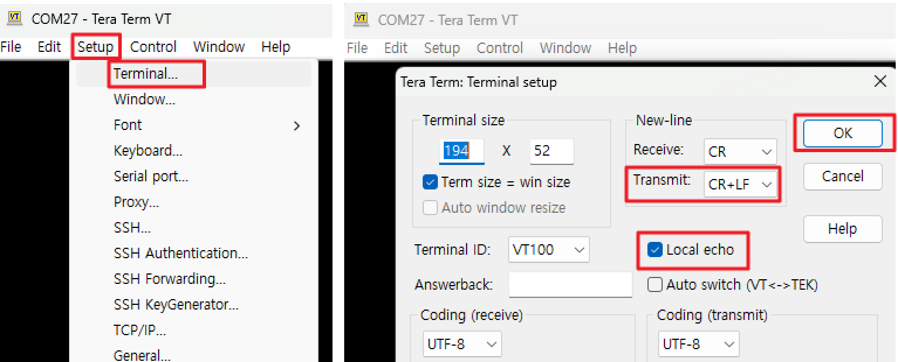
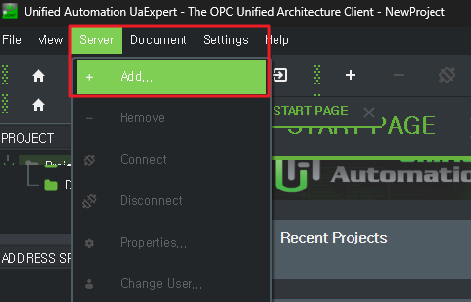
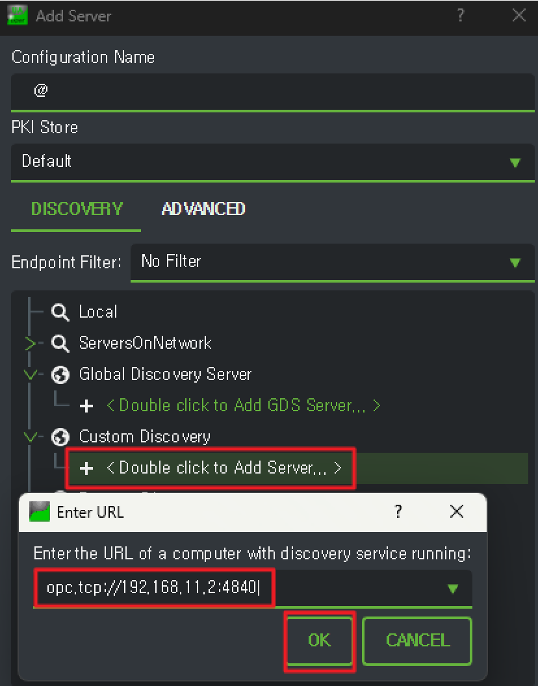

# WIZnet OPC UA Node

Firmware 1.0.1 · [한국어](README_kor.md)

Turns a WIZnet Pico board into an OPC UA server node. Values that arrive over
UART or the USB console are published as OPC UA variables, so a SCADA system,
an HMI or any OPC UA client can read them over Ethernet.

```
 sensor / PLC / MCU ──UART──►  WIZnet Pico board  ──Ethernet──►  OPC UA client
 PC terminal      ──USB───►   (OPC UA server)      opc.tcp://…:4840  (UaExpert, SCADA)
```

## Boards and security policy

The node runs on WIZnet Pico boards. Which security policy to use depends on the MCU.

| MCU | Board | Recommended policy | Tested |
|---|---|---|---|
| **RP2350** | **W6300-EVB-Pico2** | **Basic256Sha256** (encrypted) | ✅ 24-hour test |
| RP2350 | W5500-EVB-Pico2 · W6100-EVB-Pico2 | Basic256Sha256 (encrypted) | ⬜ |
| **RP2040** | **W55RP20-EVB-Pico** | **None** | ✅ |
| RP2040 | W5500-EVB-Pico · W6100-EVB-Pico · W6300-EVB-Pico | None | ⬜ |
| — | W5100S-EVB-Pico · W5100S-EVB-Pico2 | **Not supported** | — |

✅ tested on hardware · ⬜ builds, not yet tested on hardware. The table is updated as boards are tested.

### Why RP2040 boards should use None

A secure connection starts with a **handshake**: the client and the server
exchange keys with RSA-2048. Measured with the same Mbed TLS build, the handshake takes:

```
RP2350 @150 MHz  ███            1.2 s
RP2040 @200 MHz  ████████████   5.1 s   (4x slower, even overclocked)
```

RSA is mostly big-number multiplication. The RP2350's Cortex-M33 has an
instruction that multiplies two 32-bit numbers into a 64-bit result in one
step; the RP2040's Cortex-M0+ does not, so it splits the same work into many
steps. At 5 s, the handshake runs into the 5 s timeout many clients use.

So on RP2040 boards, use **None**. For encrypted connections, choose an RP2350 board.

### Why W5100S boards are not supported

The W5100S has **4 hardware sockets** — one socket carries one network
connection inside the chip.

This firmware keeps 4 sockets for OPC UA clients, so that four clients can
connect at once, and uses one more for time sync (SNTP). That is 5 sockets,
one more than the W5100S has.

So use a W5500, W6100 or W6300 board. Those chips have 8 sockets.

## Quick start

| Step | Contents |
|---|---|
| 1 | Flash the firmware |
| 2 | Set the PC address |
| 3 | Connect with UaExpert |
| 4 | Send a value and watch it change |

The quick start uses the prebuilt **None** image. **None** is the OPC UA
security policy that neither encrypts nor signs the data. It needs no
certificate, so the same prebuilt file works for everyone right away — but
anyone on the network can read the values. Use it to try the node on your own
bench network. For an encrypted connection, build the firmware yourself — see
[Build and security](docs/build-and-security.md).

### What you need

- A board from the table above, and a USB cable
- An Ethernet cable from the board to the PC
- [UaExpert](https://www.unified-automation.com/downloads/opc-ua-clients.html) (free OPC UA client)
- A serial terminal, for example [Tera Term](https://teratermproject.github.io)

No UART adapter is needed: the quick start sends values over the USB console.

## Step 1: Flash the firmware

1. Download the `.uf2` file for your board from
   [Releases](https://github.com/theoim/WIZnet_OPCUA_Node/releases).
   Releases carry files for the two tested boards, W6300-EVB-Pico2 and
   W55RP20-EVB-Pico. For the other boards in the table, build the firmware
   yourself — see [Build and security](docs/build-and-security.md).
2. Hold the **BOOTSEL** button and plug in the USB cable. A drive appears on the PC.
3. Drag the `.uf2` file onto the drive. The board restarts by itself.
4. Open the board's COM port in the terminal and type `OPCUA`. The board answers:

```
[OPC UA] state=RUNNING network=on endpoint=opc.tcp://192.168.11.2:4840 channels=3
```

`state=RUNNING` means the server is up. The boot messages themselves are
usually gone by then: the USB console only shows what the board prints after
the terminal opens, so check with a command instead.

> **Turn on local echo and send CR+LF.** The board treats CR or LF as the end
> of a command and does not echo what you type. Without these settings, your
> typing is invisible and commands never run. In Tera Term: Setup → Terminal →
> Transmit `CR+LF`, and check Local echo.



## Step 2: Set the PC address

| Item | Value |
|---|---|
| Board IP | `192.168.11.2` |
| Subnet mask | `255.255.255.0` |
| Gateway | `192.168.11.1` |
| OPC UA endpoint | `opc.tcp://192.168.11.2:4840` |

The board uses the **fixed address `192.168.11.2`**. DHCP (automatic address
assignment) is not supported: the address is a default in the firmware, so the
board is always found at the same place without a DHCP server. The PC must be
on the same network to reach it.

So connect the board straight to the PC with the Ethernet cable and give the
PC's Ethernet adapter a static address on the same network, for example
`192.168.11.100` / `255.255.255.0`. To use another address, change it in the
source code and rebuild — see [Build and security](docs/build-and-security.md).

The **endpoint** is the address an OPC UA client uses to reach the server:
`opc.tcp` (the OPC UA protocol), the board's IP, and port `4840` (the standard
OPC UA port). You enter it in UaExpert in Step 3.

> **Check with ping first.** `ping 192.168.11.2` should answer. If it does not,
> UaExpert will not find the server either — see Troubleshooting.

## Step 3: Connect with UaExpert

1. In UaExpert, choose **Server → Add...**
2. Under **Custom Discovery**, double-click `< Double click to Add Server... >`
   and enter `opc.tcp://192.168.11.2:4840`.
3. Open **WIZnet OPC UA Node** and choose **None - None (uatcp-uasc-uabinary)**.
4. Click **OK**, then connect.




The address space:

```
Objects
└── WIZnet-OPCUA-Node
    ├── Device        FwVersion, IPAddress, Uptime_s, FreeHeap, LinkStatus, ...
    └── Channels
        ├── Channel_1
        ├── Channel_2
        └── Channel_3
```

At first the channels show **Bad_WaitingForInitialData**. This status code
means no value has arrived since the board started; the board reports that
instead of showing a made-up 0. Send values with `$DATA:` (Step 4) and they show normally.

## Step 4: Send a value

Drag `Channel_1` to `Channel_3` into UaExpert's **Data Access View**, then type
this in the terminal:

```
$DATA:23.50,101.32,65.20
```

The board answers `[DATA] ok ch1=23.500 ch2=101.320 ch3=65.200`, and the three
values change in UaExpert.

### From a sensor or another MCU

| Item | Value |
|---|---|
| Port | UART0 — GP0 = TX, GP1 = RX (3.3 V logic) |
| Format | 115200 bps, 8N1 (8 data bits, no parity, 1 stop bit), no flow control |
| Line | `$DATA:<ch1>,<ch2>,<ch3>` followed by CR or LF |

**UART** is the serial link most MCUs and sensor modules have. Both ends must
use the same speed and format; if they differ, the board receives garbled
characters and rejects the line.

So set the sender to 115200 bps, 8N1, and wire it as below.

> **Cross TX and RX, and join the grounds.** The sender's TX goes to GP1 and its
> RX to GP0, because one side's transmit is the other side's receive.

## Console commands

| Command | What it does |
|---|---|
| `$DATA:<ch1>,<ch2>,<ch3>` | Set the three channels |
| `GET` | Print the channel values and frame counters |
| `NET` | Print the network status |
| `OPCUA` | Print the OPC UA server status |
| `UART` | Print the UART0 input counters |
| `NTP` | Print the clock sync status |
| `NTP a.b.c.d` | Set and save the NTP server (`0.0.0.0` = default) |
| `CLEAR` | Reset the channel values |
| `HELP` | List the commands |

## Troubleshooting

### UaExpert does not find the server

- `ping 192.168.11.2` from the PC. No answer means the PC is not on the
  `192.168.11.x` network, or the cable is not connected.
- Type `NET` in the terminal and check that the link is up.

### A fifth client cannot connect

The board accepts **4 clients at once**, one per socket. UaExpert also counts
as one. Close clients you are not using. A client that vanished without
closing its session frees its place within about 35 s.

### Channel values read Bad_WaitingForInitialData

No value has arrived since the board started. Send a `$DATA:` line (Step 4).

### UART values do not arrive

Type `UART`. A rising error count means the board receives lines it cannot
read: check that the sender uses 115200 bps, 8N1, and that each line starts
with `$DATA:` and ends with CR or LF.

## Known limitations

| What | Why | What to do |
|---|---|---|
| A secure connection start pauses the whole server for about 1.2 s (RP2350) | The handshake's RSA computation runs on the same CPU loop that answers every client. Other clients' reads wait; their connections stay up. | Give clients a timeout of 5 s or more, and avoid reconnecting often. |
| A secure connect may be refused with `Bad_TcpServerTooBusy` | When several secure connects arrive at once, a later one would wait behind the others' handshakes. The server says no at once instead of letting the client time out. | Connect again after a moment. Start clients a few seconds apart. |
| Anonymous access only | User name/password login is not implemented. | Keep the node on a network you control. |
| Any client certificate is accepted | The connection is encrypted, but the server has no trust list to check clients against. | Keep the node on a network you control. |
| Security builds embed a test key | The private key is inside the firmware image, so anyone with the `.uf2` file has the key. | Generate your own certificate for each installation. |
| Fixed IP, no DHCP | The address is a firmware default. | Set the PC to `192.168.11.x`, or change the address in source and rebuild. |
| Reduced OPC UA feature set | The server is cut to fit the RP2350's memory: no PubSub, Historizing, Events or Alarms & Conditions, and a minimal Namespace 0. Clients find the server with GetEndpoints, but it does not register with a Local Discovery Server or answer multicast discovery. | Reading values and subscriptions (monitored items) are supported. If you need the missing services, this node is not the right fit. |
| Tested clients | Tested with UaExpert and the Python `asyncua` library only. Commercial SCADA systems and PLC clients have not been tested. | Test with your own client before relying on it. Reports are welcome. |
| No certification | The server has not been through the OPC Foundation Compliance Test Tool (CTT) or a profile certification. | Treat it as a reference design, not a certified product. |

## Going further

| Document | Read it when |
|---|---|
| [Build and security](docs/build-and-security.md) | You want encrypted connections, a different IP, or another board |
| [Reference](docs/reference.md) | You need the node list, diagnostics, or status codes |
| [Test results](docs/test-results.md) | You want the measurements behind the numbers above |

## License

Apache-2.0 for this project's code. Third-party components keep their own
licenses — open62541 (MPL-2.0), Mbed TLS (Apache-2.0), Raspberry Pi Pico SDK
(BSD-3-Clause), WIZnet ioLibrary (MIT). See [NOTICE](NOTICE).
