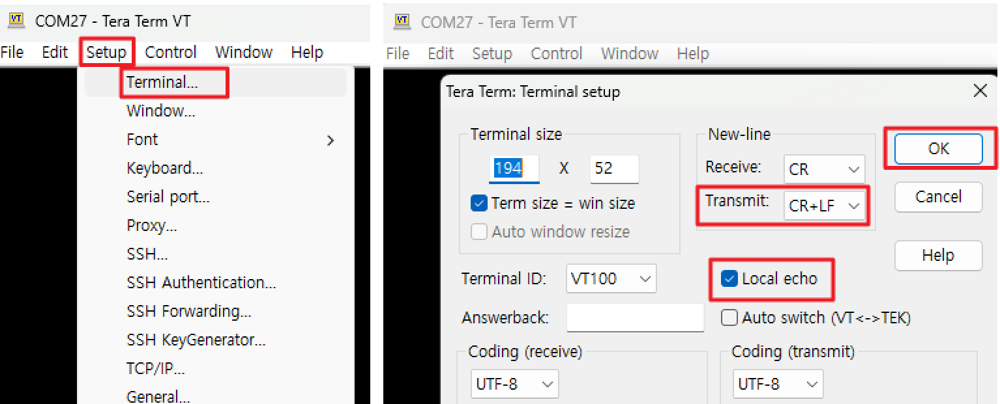
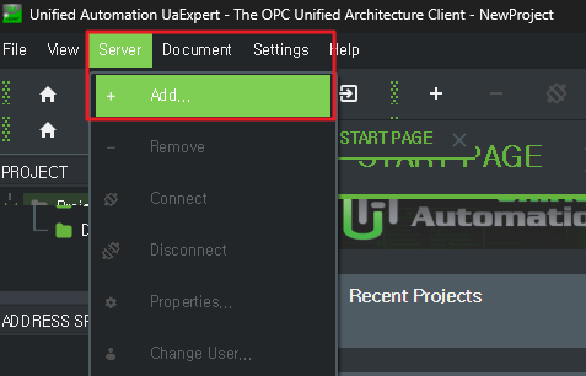
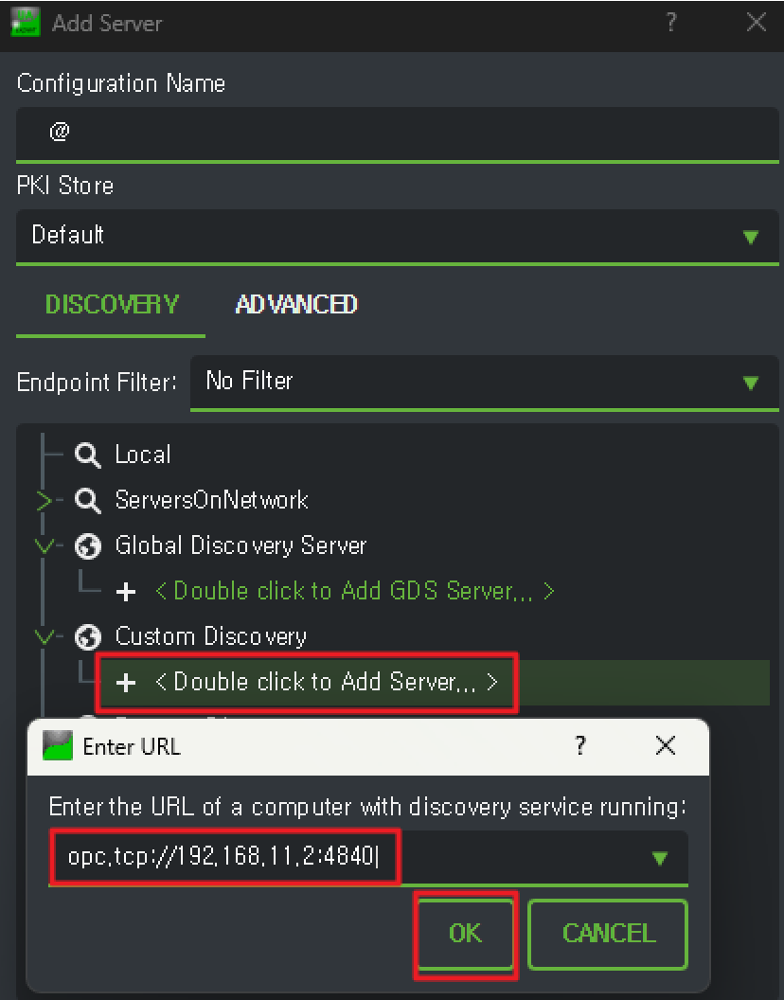

# WIZnet OPC UA Node

Firmware 1.0.0 · [English](README.md)

WIZnet Pico 보드를 OPC UA 서버 노드로 만듭니다. UART나 USB 콘솔로 들어온 값을
OPC UA 변수로 제공하므로, SCADA·HMI 같은 OPC UA 클라이언트가 이더넷으로 값을 읽을 수 있습니다.

```
 센서 / PLC / MCU ──UART──►  WIZnet Pico 보드   ──이더넷──►  OPC UA 클라이언트
 PC 터미널        ──USB───►  (OPC UA 서버)       opc.tcp://…:4840  (UaExpert, SCADA)
```

## 보드와 보안 정책

WIZnet Pico 보드에서 노드로 동작합니다. 보안 정책은 보드의 MCU에 따라 고릅니다.

| MCU | 보드 | 권장 정책 | 시험 |
|---|---|---|---|
| **RP2350** | **W6300-EVB-Pico2** | **Basic256Sha256** (암호화) | ✅ 24시간 시험 |
| RP2350 | W5500-EVB-Pico2 · W6100-EVB-Pico2 | Basic256Sha256 (암호화) | ⬜ |
| **RP2040** | **W55RP20-EVB-Pico** | **None** | ✅ |
| RP2040 | W5500-EVB-Pico · W6100-EVB-Pico · W6300-EVB-Pico | None | ⬜ |
| — | W5100S-EVB-Pico · W5100S-EVB-Pico2 | **지원 안 함** | — |

✅ 실제 보드로 시험함 · ⬜ 빌드는 되지만 보드 시험 전. 시험이 끝나는 대로 표를 갱신합니다.

### RP2040 보드에 None을 권장하는 이유

보안 접속은 **핸드셰이크**로 시작합니다. 클라이언트와 서버가 RSA-2048로 키를 주고받는
과정입니다. 같은 Mbed TLS 빌드로 측정한 핸드셰이크 시간은 다음과 같습니다.

```
RP2350 @150 MHz  ███            1.2 s
RP2040 @200 MHz  ████████████   5.1 s   (오버클럭해도 4배 느림)
```

RSA 계산은 대부분 큰 수 곱셈입니다. RP2350의 Cortex-M33에는 32비트 두 수를 곱해 64비트 결과를
한 번에 내는 명령이 있고, RP2040의 Cortex-M0+에는 이 명령이 없어 같은 계산을 여러 단계로 나눠
합니다. 5초가 걸리면 많은 클라이언트가 쓰는 5초 타임아웃에 걸립니다.

그래서 RP2040 보드는 **None**으로 사용합니다. 암호화 연결이 필요하면 RP2350 보드를 고릅니다.

### W5100S 보드를 지원하지 않는 이유

W5100S는 **하드웨어 소켓이 4개**입니다. 소켓 하나가 칩 안에서 네트워크 연결 하나를 맡습니다.

이 펌웨어는 클라이언트 4개가 동시에 접속할 수 있도록 OPC UA용으로 소켓 4개를 열어 두고,
시간 동기화(SNTP)에 1개를 더 씁니다. 모두 5개로, W5100S보다 하나가 많습니다.

그래서 W5500, W6100, W6300 보드를 사용합니다. 이 칩들은 소켓이 8개입니다.

## 빠른 시작

| 단계 | 내용 |
|---|---|
| 1 | 펌웨어 올리기 |
| 2 | PC 주소 설정 |
| 3 | UaExpert로 접속 |
| 4 | 값을 보내고 바뀌는 것 확인 |

빠른 시작은 미리 빌드한 **None** 이미지를 사용합니다. **None**은 데이터를 암호화하지도,
서명하지도 않는 OPC UA 보안 정책입니다. 인증서가 필요 없어서 같은 파일을 누구나 바로 쓸 수
있지만, 같은 네트워크의 누구나 값을 읽을 수 있습니다. 그래서 None은 내 책상 위 시험용
네트워크에서 체험할 때 씁니다. 암호화 연결이 필요하면 펌웨어를 직접 빌드합니다 —
[빌드와 보안](docs/build-and-security_kor.md) 참조.

### 준비물

- 위 표의 보드와 USB 케이블
- 보드와 PC를 잇는 랜선
- [UaExpert](https://www.unified-automation.com/downloads/opc-ua-clients.html) (무료 OPC UA 클라이언트)
- 시리얼 터미널. 예: [Tera Term](https://teratermproject.github.io)

UART 어댑터는 필요 없습니다. 빠른 시작에서는 USB 콘솔로 값을 보냅니다.

## 1단계: 펌웨어 올리기

1. [Releases](https://github.com/theoim/WIZnet_OPCUA_Node/releases)에서 보드에 맞는 `.uf2` 파일을 받습니다.
2. **BOOTSEL** 버튼을 누른 채 USB 케이블을 꽂습니다. PC에 드라이브가 나타납니다.
3. `.uf2` 파일을 드라이브에 끌어 놓습니다. 보드가 스스로 다시 시작합니다.
4. 터미널에서 보드의 COM 포트를 엽니다. 부팅 로그는 다음과 같이 시작합니다.

```
=== WIZnet OPC UA Node (Phase A) ===
build <commit> <time>  security=...
```

> **로컬 에코와 CR+LF 전송을 켜 주세요.** 보드는 CR이나 LF를 명령의 끝으로 보고, 입력한
> 글자를 되돌려 보내지 않습니다. 이 설정이 없으면 입력이 화면에 보이지 않고 명령도 실행되지
> 않습니다. Tera Term에서 Setup → Terminal → Transmit을 `CR+LF`로 바꾸고 Local echo를 체크합니다.



## 2단계: PC 주소 설정

| 항목 | 값 |
|---|---|
| 보드 IP | `192.168.11.2` |
| 서브넷 마스크 | `255.255.255.0` |
| 게이트웨이 | `192.168.11.1` |
| OPC UA 엔드포인트 | `opc.tcp://192.168.11.2:4840` |

보드는 **고정 주소 `192.168.11.2`**를 씁니다. DHCP(주소 자동 할당)는 지원하지 않습니다.
주소가 펌웨어 기본값으로 정해져 있어서, DHCP 서버가 없어도 항상 같은 주소로 찾을 수 있습니다.
대신 PC가 같은 대역에 있어야 보드에 닿습니다.

그래서 보드를 PC에 랜선으로 직접 연결하고, PC 이더넷 어댑터에 같은 대역의 고정 주소를 줍니다.
예: `192.168.11.100` / `255.255.255.0`. 다른 주소를 쓰려면 소스코드에서 바꾸고 다시 빌드합니다 —
[빌드와 보안](docs/build-and-security_kor.md) 참조.

**엔드포인트(Endpoint)** 는 OPC UA 클라이언트가 서버를 찾아가는 주소입니다. `opc.tcp`(OPC UA
프로토콜), 보드 IP, 포트 `4840`(OPC UA 표준 포트)으로 이루어집니다. 3단계에서 UaExpert에 입력합니다.

> **먼저 ping으로 확인해 주세요.** `ping 192.168.11.2`에 응답이 와야 합니다. 응답이 없으면
> UaExpert도 서버를 찾지 못합니다 — 아래 문제 해결 참조.

## 3단계: UaExpert로 접속

1. UaExpert에서 **Server → Add...** 를 고릅니다.
2. **Custom Discovery** 아래 `< Double click to Add Server... >`를 더블클릭하고
   `opc.tcp://192.168.11.2:4840`을 입력합니다.
3. **WIZnet OPC UA Node**를 펼쳐 **None - None (uatcp-uasc-uabinary)** 를 고릅니다.
4. **OK**를 누르고 접속합니다.




접속하면 다음 노드가 보입니다.

```
Objects
└── WIZnet-OPCUA-Node
    ├── Device        FwVersion, IPAddress, Uptime_s, FreeHeap, LinkStatus, ...
    └── Channels
        ├── Channel_1
        ├── Channel_2
        └── Channel_3
```

처음에는 채널 값이 **Bad_WaitingForInitialData**로 보입니다. 보드가 시작한 뒤 아직 값을 받지
못했다는 상태 코드입니다. 보드는 꾸며낸 0을 보여 주는 대신 이 상태를 알립니다. `$DATA:` 명령으로
값을 보내면(4단계) 정상적으로 표시됩니다.

## 4단계: 값 보내기

`Channel_1`~`Channel_3`을 UaExpert의 **Data Access View**로 끌어 놓고, 터미널에 입력합니다.

```
$DATA:23.50,101.32,65.20
```

보드가 `[DATA] ok ch1=23.500 ch2=101.320 ch3=65.200`으로 답하고, UaExpert의 세 값이 바뀝니다.

### 센서나 다른 MCU에서 보낼 때

| 항목 | 값 |
|---|---|
| 포트 | UART0 — GP0 = TX, GP1 = RX (3.3 V 로직) |
| 형식 | 115200bps, 8N1(데이터 8비트, 패리티 없음, 정지 비트 1개), 흐름 제어 없음 |
| 한 줄 | `$DATA:<ch1>,<ch2>,<ch3>` 뒤에 CR 또는 LF |

**UART**는 대부분의 MCU와 센서 모듈에 있는 직렬 통신 방식입니다. 양쪽의 속도와 형식이 같아야
하고, 다르면 보드가 깨진 글자를 받아 그 줄을 버립니다.

그래서 보내는 쪽을 115200bps, 8N1로 맞추고 아래와 같이 연결합니다.

> **TX와 RX를 교차 연결하고 GND를 서로 이어 주세요.** 한쪽의 송신(TX)이 다른 쪽의 수신(RX)이
> 되므로, 보내는 쪽 TX는 GP1에, RX는 GP0에 연결합니다.

## 콘솔 명령

| 명령 | 동작 |
|---|---|
| `$DATA:<ch1>,<ch2>,<ch3>` | 세 채널 값 설정 |
| `GET` | 채널 값과 프레임 카운터 출력 |
| `NET` | 네트워크 상태 출력 |
| `OPCUA` | OPC UA 서버 상태 출력 |
| `UART` | UART0 입력 카운터 출력 |
| `NTP` | 시간 동기화 상태 출력 |
| `NTP a.b.c.d` | NTP 서버 설정·저장 (`0.0.0.0` = 기본값) |
| `CLEAR` | 채널 값 초기화 |
| `HELP` | 명령 목록 |

## 문제 해결

### UaExpert가 서버를 찾지 못합니다

- PC에서 `ping 192.168.11.2`를 실행합니다. 응답이 없으면 PC 주소가 `192.168.11.x` 대역이 아니거나 랜선이 빠진 것입니다.
- 터미널에 `NET`을 입력해 링크가 올라왔는지 확인합니다.

### 다섯 번째 클라이언트가 접속하지 못합니다

보드는 소켓 하나에 클라이언트 하나씩, **동시에 4개까지** 받습니다. UaExpert도 하나로 셉니다.
쓰지 않는 클라이언트를 닫아 주세요. 세션을 닫지 않고 사라진 클라이언트의 자리는 약 35초 안에 풀립니다.

### 채널 값이 Bad_WaitingForInitialData로 보입니다

보드가 시작한 뒤 아직 값을 받지 못했습니다. `$DATA:` 줄을 보냅니다(4단계).

### UART 값이 들어오지 않습니다

`UART`를 입력합니다. 오류 수가 늘어나면 보드가 읽을 수 없는 줄을 받고 있다는 뜻입니다.
보내는 쪽이 115200bps, 8N1인지, 각 줄이 `$DATA:`로 시작해 CR 또는 LF로 끝나는지 확인합니다.

## 알려진 한계

| 무엇 | 왜 | 어떻게 |
|---|---|---|
| 보안 접속이 시작될 때 서버 전체가 약 1.2초 멈춥니다(RP2350) | 핸드셰이크의 RSA 계산이 모든 클라이언트에 응답하는 같은 CPU 루프에서 돌기 때문입니다. 다른 클라이언트의 읽기는 기다리지만 연결은 끊기지 않습니다. | 클라이언트 타임아웃을 5초 이상으로 두고, 재접속을 자주 하지 않습니다. |
| 보안 접속이 `Bad_TcpServerTooBusy`로 거절될 수 있습니다 | 보안 접속이 한꺼번에 몰리면 뒤 접속이 앞 접속들의 핸드셰이크를 오래 기다리게 됩니다. 서버는 클라이언트가 타임아웃될 때까지 두지 않고 바로 거절합니다. | 잠시 후 다시 연결합니다. 클라이언트를 몇 초 간격으로 시작합니다. |
| 익명 접속만 지원합니다 | 사용자 이름·비밀번호 로그인이 구현되어 있지 않습니다. | 직접 관리하는 네트워크에 둡니다. |
| 클라이언트 인증서를 모두 받아들입니다 | 통신은 암호화되지만, 서버에 클라이언트를 대조할 신뢰 목록이 없습니다. | 직접 관리하는 네트워크에 둡니다. |
| 보안 빌드에 시험용 키가 들어갑니다 | 개인키가 펌웨어 이미지 안에 있어서, `.uf2` 파일을 가진 사람은 키도 갖습니다. | 설치할 때마다 인증서를 직접 생성합니다. |
| 고정 IP이고 DHCP가 없습니다 | 주소가 펌웨어 기본값으로 정해져 있습니다. | PC를 `192.168.11.x`로 맞추거나, 소스에서 주소를 바꿔 다시 빌드합니다. |

## 더 알아보기

| 문서 | 이럴 때 읽습니다 |
|---|---|
| [빌드와 보안](docs/build-and-security_kor.md) | 암호화 연결, 다른 IP, 다른 보드가 필요할 때 |
| [레퍼런스](docs/reference_kor.md) | 노드 목록, 진단 값, 상태 코드가 필요할 때 |
| [시험 결과](docs/test-results_kor.md) | 위 수치의 근거가 궁금할 때 |

## 라이선스

이 프로젝트의 코드는 Apache-2.0입니다. 외부 구성요소는 각자의 라이선스를 따릅니다 —
open62541 (MPL-2.0), Mbed TLS (Apache-2.0), Raspberry Pi Pico SDK (BSD-3-Clause),
WIZnet ioLibrary (MIT). [NOTICE](NOTICE) 참조.
